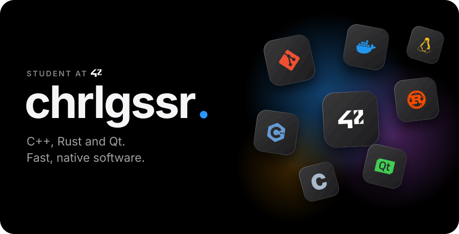
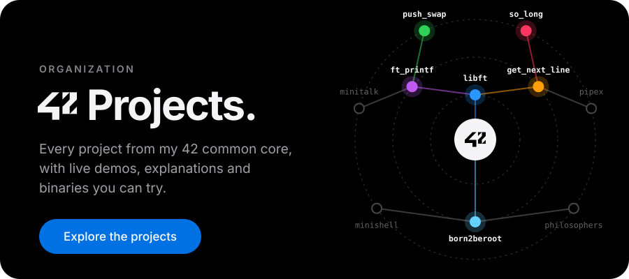
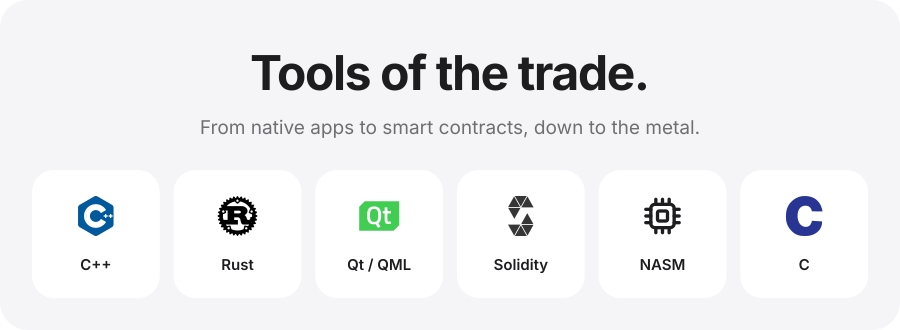

<!-- chrlgssr's profile README. Images live in assets/.
     Replace YOUR-LINKEDIN, YOUR-DISCORD and YOUR-EMAIL below. -->

<picture></picture>

  <a href="https://github.com/chrlgssr"><picture><source media="(prefers-color-scheme: dark)" srcset="./assets/icon-github-dark.svg"></picture></a>&nbsp;&nbsp;&nbsp;&nbsp;
  <a href="https://www.linkedin.com/in/YOUR-LINKEDIN"><picture><source media="(prefers-color-scheme: dark)" srcset="./assets/icon-linkedin-dark.svg"></picture></a>&nbsp;&nbsp;&nbsp;&nbsp;
  <a href="https://discord.com/users/YOUR-DISCORD"><picture><source media="(prefers-color-scheme: dark)" srcset="./assets/icon-discord-dark.svg"></picture></a>&nbsp;&nbsp;&nbsp;&nbsp;
  <a href="mailto:YOUR-EMAIL"><picture><source media="(prefers-color-scheme: dark)" srcset="./assets/icon-email-dark.svg"></picture></a>

 

  

<picture></picture>

 

Made by chrlgssr, student at 42 · Designed with care. Hosted on GitHub.

